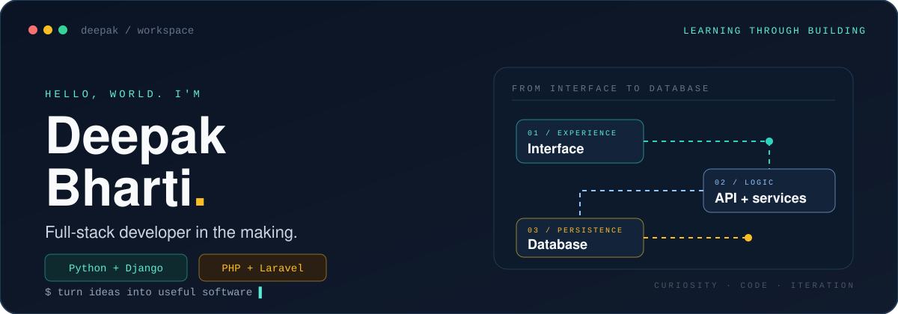

  

<a href="#01--behind-the-code">About</a> ·
<a href="#02--selected-builds">Projects</a> ·
<a href="#03--my-toolbox">Stack</a> ·
<a href="#04--the-work-in-progress">Activity</a>

---

## 01 / Behind the code

I'm **Deepak Bharti**, a Trainee Software Developer at **Softpro India Pvt. Ltd., Lucknow**, building web applications with **Python / Django** and **PHP / Laravel**. I enjoy connecting the pieces: a useful interface, a clear API, and a database that makes sense.

I'm sharpening my backend engineering skills with Django REST Framework, learning React, and practising data structures in C.

| Building with | Learning toward | Experience |
|---|---|---|
| Django · Laravel · MySQL | REST APIs, React, DSA | Trainee Developer at Softpro India Pvt. Ltd. |

---

## 02 / Selected builds

<table>
<tr>
<td width="50%" valign="top">

**01 &nbsp; AutoGrade-AI**

Automated grading system using Artificial Intelligence and Digital Image Processing.

`Python` `Django` `Image Processing`

[Explore the repository →](https://github.com/deepakbharti-cloud/AutoGrade-AI)

</td>
<td width="50%" valign="top">

**02 &nbsp; Smart-Build-Hub**

A platform connecting contractors and homeowners.

`Django` `MySQL` `HTML` `CSS`

[Explore the repository →](https://github.com/deepakbharti-cloud/Smart-Build-Hub1)

</td>
</tr>
<tr>
<td width="50%" valign="top">

**03 &nbsp; Online Job Portal**

An online job portal project for listing and applying to jobs.

`Python` `Django`

[Explore the repository →](https://github.com/deepakbharti-cloud/Online-Job-Portal)

</td>
<td width="50%" valign="top">

**04 &nbsp; File Tracking System**

A file tracking system for managing and following documents.

`JavaScript` `Web application`

[Explore the repository →](https://github.com/deepakbharti-cloud/File-Trackin-System_Project)

</td>
</tr>
</table>

<b>Explore more public repositories</b>

 

- [LocalRepo](https://github.com/deepakbharti-cloud/LocalRepo)
- [Demo1-Project](https://github.com/deepakbharti-cloud/Demo1-Project)
- [All repositories →](https://github.com/deepakbharti-cloud?tab=repositories)

---

## 03 / My toolbox

<table>
<tr>
<td width="33%" valign="top">

**01 / THE EXPERIENCE**
### Frontend

HTML · CSS · JavaScript 
Bootstrap · Tailwind CSS · React

*Interfaces that make sense.*

</td>
<td width="33%" valign="top">

**02 / THE ENGINE**
### Backend

Python · Django · DRF 
PHP · Laravel · REST APIs

*Logic behind the experience.*

</td>
<td width="33%" valign="top">

**03 / THE FOUNDATION**
### Data + tools

MySQL · MongoDB · Redis 
Git · GitHub · VS Code

*Structure. Version. Improve.*

</td>
</tr>
</table>

**Also in my toolkit:** C programming. **Currently exploring:** Django REST Framework, React and data structures.

---

## 04 / The work in progress

**Current direction:** stronger backend APIs, clearer database design, responsive interfaces and solid fundamentals in DSA.

---

### Have something useful in mind? Let's build it.

Happy to connect over **Django, Laravel, web applications and learning together.**

[Portfolio](https://deepakbharti-cloud.github.io/my-portfolio/) / [LinkedIn](https://www.linkedin.com/in/deepak-bharti-ab7622315) / [Email](mailto:drao18601@gmail.com)

**LEARN. BUILD. REFINE. REPEAT.**

